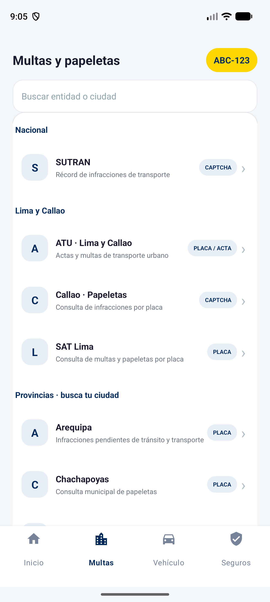
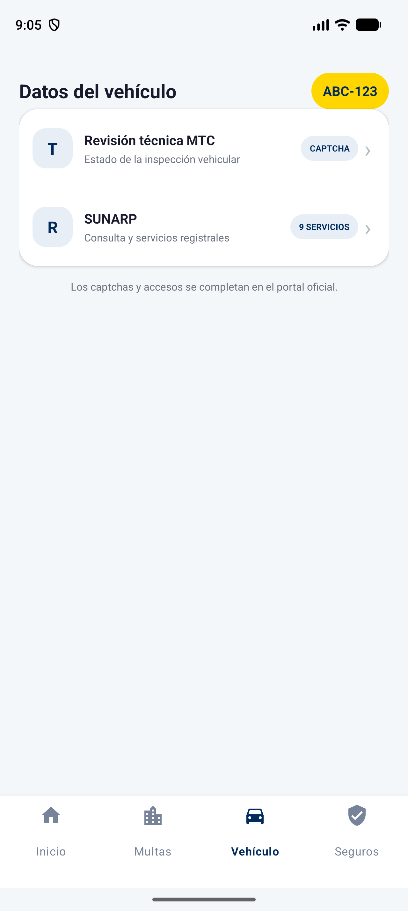
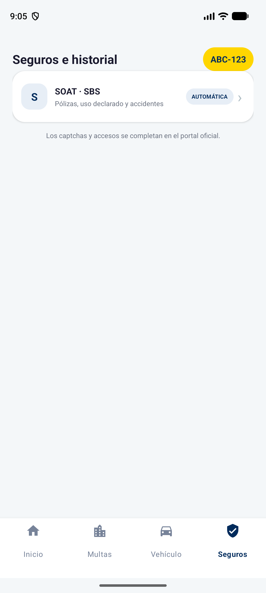

# AUTOCAR — Consulta vehicular en Perú

Aplicación Android que centraliza el acceso a consultas vehiculares por placa y presenta un resumen de las fuentes consultadas. Incluye un directorio de multas y papeletas, consultas de SUNARP, SOAT mediante SBS, infracciones SUTRAN y revisión técnica MTC.

Es un prototipo en desarrollo para evaluar la eficiencia de acceso a información. No es una aplicación oficial de las entidades y no certifica la ausencia de multas, accidentes o cargas registrales.

## Capturas de la aplicación

Capturas reales del emulador Android, tomadas el 10 de octubre de 2026. `ABC-123` es una placa de ejemplo introducida para mostrar la interfaz; no se realizó una consulta con ella. Estas imágenes documentan las pantallas, no resultados oficiales ni mediciones del piloto.

<p align="center">
  
  
  
</p>

De izquierda a derecha: **Multas y papeletas**, **Datos del vehículo** y **Seguros e historial**. Todas conservan el menú inferior para cambiar de sección.

## Funciones implementadas

- Ingreso, normalización y validación de placas peruanas; historial local de placas recientes.
- Navegación inferior: Inicio, Multas, Vehículo y Seguros.
- Directorio de fuentes nacionales y municipales, con consultas abiertas en WebView y opción de abrir el navegador externo.
- Consulta conjunta de SUNARP, SBS/SOAT, SUTRAN y MTC, con estados individuales y resultados parciales.
- Pantalla de verificación para introducir manualmente los códigos de seguridad de SUTRAN y MTC, conservando la sesión de cada consulta.
- Resumen de pólizas reportadas por SBS, vigencias, uso declarado e información de siniestralidad disponible.
- Generación y compartición de un informe PDF; puede adjuntar la imagen oficial recibida de SUNARP.

Los captchas se completan por el usuario: no se implementa su evasión. El reconocimiento de texto mediante ML Kit se utiliza para información de resultados; su precisión no está garantizada.

## Alcance y limitaciones

La consulta conjunta no incluye todavía la recopilación automática de todas las multas municipales. El directorio municipal facilita el acceso a cada portal, pero no consolida sus papeletas en el PDF.

La disponibilidad depende de los servicios externos, sus certificados, formularios y controles de seguridad. Un portal accesible por HTTP no demuestra que una consulta por placa funcione de principio a fin. Un fallo, una consulta pendiente o un captcha sin resolver nunca deben interpretarse como cero multas.

El reporte SBS puede tener desfase de actualización. El uso declarado en una póliza describe ese registro, no demuestra toda la historia de uso del vehículo. El resumen es orientativo y no reemplaza documentos oficiales ni una inspección previa a la compra.

## Tecnología

Aunque el repositorio se llama `autocar-consulta-vehicular-kotlin`, las pantallas y la lógica principal actuales están escritas en **Java**, con vistas XML y Android WebView. Kotlin aparece en las pruebas y en los archivos de configuración Gradle Kotlin DSL. No utiliza React Native ni Expo.

| Componente | Configuración del proyecto |
|---|---|
| Identificador | `com.example.app_autocar` |
| Versión | `1.0` — código `1` |
| Android mínimo | API 34 (Android 14) |
| SDK de compilación y destino | API 37 |
| Gradle Wrapper | 9.6.0, con checksum configurado |
| Compatibilidad Java del código | Java 11 |
| Interfaz | AppCompat, Material Components, XML |
| Reconocimiento de texto | Google ML Kit |
| PDF | Android `PdfDocument` y `FileProvider` |

## Ejecutar en Android Studio

1. Clonar el repositorio y abrir su carpeta raíz en Android Studio.
2. Instalar el SDK Android API 37 y configurar el JDK compatible con el Gradle del proyecto; en el entorno de desarrollo se utiliza el JDK incluido en Android Studio.
3. Sincronizar Gradle. Se requiere conexión para descargar la distribución y las dependencias.
4. Seleccionar un dispositivo o emulador con API 34 o superior y ejecutar el módulo `app`.

Android Studio genera `local.properties` con la ruta local del SDK. Este archivo no se publica.

```bash
git clone https://github.com/HEYLER1/autocar-consulta-vehicular-kotlin.git
cd autocar-consulta-vehicular-kotlin
./gradlew :app:testDebugUnitTest :app:assembleDebug :app:lintDebug
```

Si aparece `UnknownHostException: services.gradle.org`, comprobar conexión, DNS y configuración de proxy. No desactivar la validación TLS para resolverlo.

### Integración opcional con PlacAPI

El proyecto lee `PLACAPI_KEY` desde `local.properties` únicamente para la compilación de depuración. Sin clave, utiliza el flujo de los portales oficiales. La compilación release deja esta clave vacía.

Una clave incorporada en un APK puede extraerse: para producción, cualquier servicio privado debe gestionarse mediante un backend y credenciales restringidas. No publicar claves, archivos de firma ni datos personales de consultas.

## Evidencia y estado de validación

Las evidencias técnicas y sus límites se documentan en [Verificación técnica](docs/verificacion_tecnica.md). El inventario histórico de fuentes y sus observaciones está en [Fuentes de multas](docs/fuentes_multas_peru.md); algunos enlaces de ese inventario requieren revalidación y no representan exactamente el directorio actual.

| Función | Evidencia en el código |
|---|---|
| Placas y validación | [PlateUtils.java](app/src/main/java/com/example/app_autocar/PlateUtils.java), [pruebas unitarias](app/src/test/java/com/example/app_autocar/ExampleUnitTest.kt) |
| Menú y directorio | [MainActivity.java](app/src/main/java/com/example/app_autocar/MainActivity.java), [menú inferior](app/src/main/res/menu/main_navigation.xml) |
| Portales y navegación | [WebViewActivity.java](app/src/main/java/com/example/app_autocar/WebViewActivity.java) |
| Consulta conjunta, verificación e informe PDF | [MultiCheckActivity.java](app/src/main/java/com/example/app_autocar/MultiCheckActivity.java) |
| Restricciones de red | [network_security_config.xml](app/src/main/res/xml/network_security_config.xml) |

La presencia de código, una compilación exitosa y las pruebas unitarias no equivalen a una validación completa de los portales ni del contenido del PDF.

## Investigación y prueba piloto

El prototipo permite preparar comparaciones entre consulta directa y consulta desde la app. Todavía no se publican resultados experimentales que demuestren reducción de tiempo o pasos, cobertura completa o concordancia de resultados municipales.

El piloto debe seleccionar fuentes con consulta por placa verificable, congelar la versión evaluada y registrar pares de consultas con la misma placa, fuente, dispositivo y conexión. Deben medirse tiempo, acciones, cobertura y concordancia, conservando incidencias y consultas fallidas. Las fichas de medición pueden ser externas a la app.

SUNARP, SOAT y revisión técnica son funciones complementarias; no sustituyen la muestra de multas municipales. La descripción tecnológica del protocolo debe corresponder a la implementación nativa actual.

## Estructura

```text
app/src/main/java/com/example/app_autocar/  Actividades y lógica
app/src/main/res/                          Vistas, estilos y configuración
app/src/test/                             Pruebas unitarias
app/src/androidTest/                      Pruebas instrumentadas
docs/                                     Inventario y evidencias
gradle/                                   Wrapper y catálogo de versiones
```

## Autoría y licencia

Proyecto mantenido por [HEYLER1](https://github.com/HEYLER1). No se ha añadido una licencia de uso: la publicación del código no implica una licencia abierta. Los nombres y servicios de terceros pertenecen a sus respectivas entidades.
