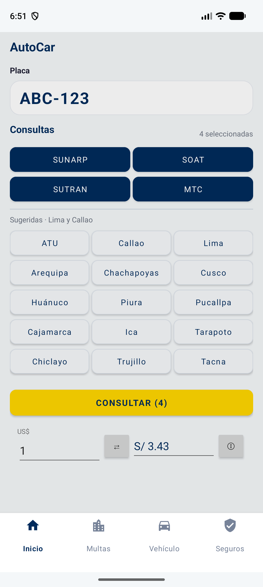
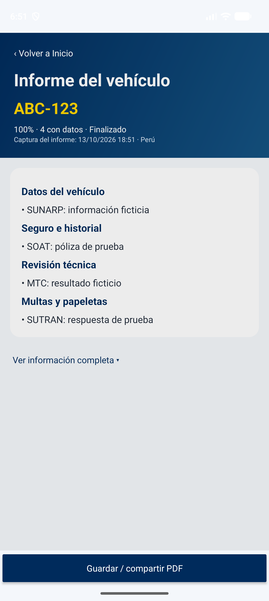

# AUTOCAR — Consulta vehicular en Perú

Aplicación Android que centraliza el acceso a consultas vehiculares por placa y presenta un resumen de las fuentes consultadas. Incluye un directorio de multas y papeletas, consultas de SUNARP, SOAT mediante SBS, infracciones SUTRAN y revisión técnica MTC.

Es un prototipo en desarrollo para evaluar la eficiencia de acceso a información. No es una aplicación oficial de las entidades y no certifica la ausencia de multas, accidentes o cargas registrales.

## Capturas de la aplicación

Capturas de la versión actual en el emulador Android, tomadas el 13 de octubre de 2026. Inicio utiliza `ABC-123` como ejemplo, sin consultar esa placa. El informe muestra **datos ficticios de una prueba de interfaz**, no resultados oficiales ni mediciones del piloto. No se publican propietarios, DNI ni resultados personales.

<p align="center">
  
  
</p>

De izquierda a derecha: **Inicio** e **Informe general**. La consulta y los captchas permanecen en Inicio; «Ver resultados», debajo del progreso, abre el informe a pantalla completa.

## Funciones implementadas

- Ingreso, normalización y validación de placas peruanas; historial local de placas recientes.
- Navegación inferior: Inicio, Multas, Vehículo y Seguros.
- Directorio de fuentes nacionales y municipales, con consultas abiertas en WebView y opción de abrir el navegador externo.
- SUNARP, SOAT/SBS, SUTRAN y MTC preseleccionados y separados de las ciudades; el usuario puede desmarcarlos. Se ejecutan únicamente las fuentes seleccionadas.
- El mismo botón alterna entre **Consultar** y **Cancelar**, impidiendo iniciar una segunda consulta mientras la primera sigue activa.
- Porcentaje por fuentes terminadas, con datos recibidos, errores y verificaciones pendientes diferenciados.
- Captchas compactos y ocultos hasta abrir «Verificar»; las sesiones no se recargan al enviar códigos.
- Recomendaciones orientativas por prefijo de placa: las fuentes locales aparecen primero después de las prioritarias, sin seleccionarse automáticamente. La zona registral no determina dónde puede haber multas.
- Conversor de soles y dólares visible en Inicio. Utiliza una tasa diaria referencial de ExchangeRate-API; no es una cotización bancaria en tiempo real. El monto ingresado no se envía a la API.
- Informe general a pantalla completa, agrupado en vehículo, seguro, revisión técnica y multas, con el detalle extraído completo desplegable.
- Flujo conjunto de multas por placa, con adaptadores por fuente, verificaciones agrupadas e informe PDF que se actualiza con los datos recibidos y los estados pendientes.
- Pantalla de verificación para introducir manualmente los códigos de seguridad de SUTRAN y MTC, conservando la sesión de cada consulta.
- Resumen de pólizas reportadas por SBS, vigencias, uso declarado e información de siniestralidad disponible.
- Generación y compartición de un informe PDF; puede adjuntar la imagen oficial recibida de SUNARP.

Los captchas se completan por el usuario: no se implementa su evasión. El reconocimiento de texto mediante ML Kit se utiliza para información de resultados; su precisión no está garantizada.

## Alcance y limitaciones

Inicio inicia las consultas seleccionadas y reúne el detalle extraído en un PDF. Las fuentes prioritarias reutilizan el motor anterior; las municipales conservan adaptadores propios. La automatización depende del formulario y de la disponibilidad de cada fuente: no todas pueden completarse sólo con una placa. El informe identifica consultas incompletas, errores y verificaciones pendientes; no debe presentarse como cobertura municipal total. Véase la [revisión por fuente](docs/verificacion_fuentes_2026-10-13.md).

El informe a pantalla completa es una captura del estado al abrirlo: si quedan consultas pendientes, se vuelve a Inicio y se abre de nuevo para obtener un informe actualizado. El PDF asociado conserva ese estado.

La disponibilidad depende de los servicios externos, sus certificados, formularios y controles de seguridad. Un portal accesible por HTTP no demuestra que una consulta por placa funcione de principio a fin. Un fallo, una consulta pendiente o un captcha sin resolver nunca deben interpretarse como cero multas.

El reporte SBS puede tener desfase de actualización. El uso declarado en una póliza describe ese registro, no demuestra toda la historia de uso del vehículo. El resumen es orientativo y no reemplaza documentos oficiales ni una inspección previa a la compra.

## Tecnología

Aunque el repositorio se llama `autocar-consulta-vehicular-kotlin`, las pantallas y la lógica principal actuales están escritas en **Java**, con vistas XML y Android WebView. Kotlin aparece en las pruebas y en los archivos de configuración Gradle Kotlin DSL. No utiliza React Native ni Expo.

| Componente | Configuración del proyecto |
|---|---|
| Identificador | `com.example.app_autocar` |
| Versión | `1.0` — código `1` |
| Android mínimo | API 34 (Android 14) |
| SDK de compilación y destino | API 37 |
| Gradle Wrapper | 9.6.0, con checksum configurado |
| Compatibilidad Java del código | Java 11 |
| Interfaz | AppCompat, Material Components, XML |
| Reconocimiento de texto | Google ML Kit |
| PDF | Android `PdfDocument` y `FileProvider` |

## Ejecutar en Android Studio

### Instalar el APK de prueba

[Descargar AUTOCAR 1.0 con logo](https://github.com/HEYLER1/autocar-consulta-vehicular-kotlin/raw/refs/heads/main/dist/AUTOCAR-1.0.apk)

APK de depuración firmado, generado el 13 de octubre de 2026 y guardado en `dist/AUTOCAR-1.0.apk`. Requiere Android 14 (API 34) o superior. Android puede solicitar permiso para instalar aplicaciones desde el navegador o administrador de archivos. No es una versión de producción ni se publica en Google Play.

La compilación, las pruebas unitarias y lint se verifican antes de publicar. Las pruebas instrumentadas comprueban selección, cancelación, progreso, captchas con formularios ficticios y renderizado del informe; no certifican todas las consultas reales de los portales externos.

### Abrir y compilar el proyecto

1. Clonar el repositorio y abrir su carpeta raíz en Android Studio.
2. Instalar el SDK Android API 37 y configurar el JDK compatible con el Gradle del proyecto; en el entorno de desarrollo se utiliza el JDK incluido en Android Studio.
3. Sincronizar Gradle. Se requiere conexión para descargar la distribución y las dependencias.
4. Seleccionar un dispositivo o emulador con API 34 o superior y ejecutar el módulo `app`.

Android Studio genera `local.properties` con la ruta local del SDK. Este archivo no se publica.

```bash
git clone https://github.com/HEYLER1/autocar-consulta-vehicular-kotlin.git
cd autocar-consulta-vehicular-kotlin
./gradlew :app:testDebugUnitTest :app:assembleDebug :app:lintDebug
```

Si aparece `UnknownHostException: services.gradle.org`, comprobar conexión, DNS y configuración de proxy. No desactivar la validación TLS para resolverlo.

### Integración opcional con PlacAPI

El proyecto lee `PLACAPI_KEY` desde `local.properties` únicamente para la compilación de depuración. Sin clave, utiliza el flujo de los portales oficiales. La compilación release deja esta clave vacía.

Una clave incorporada en un APK puede extraerse: para producción, cualquier servicio privado debe gestionarse mediante un backend y credenciales restringidas. No publicar claves, archivos de firma ni datos personales de consultas.

## Evidencia y estado de validación

Las evidencias técnicas y sus límites se documentan en [Verificación técnica](docs/verificacion_tecnica.md). El inventario histórico de fuentes y sus observaciones está en [Fuentes de multas](docs/fuentes_multas_peru.md); algunos enlaces de ese inventario requieren revalidación y no representan exactamente el directorio actual.

| Función | Evidencia en el código |
|---|---|
| Placas y validación | [PlateUtils.java](app/src/main/java/com/example/app_autocar/PlateUtils.java), [pruebas unitarias](app/src/test/java/com/example/app_autocar/ExampleUnitTest.kt) |
| Menú y directorio | [MainActivity.java](app/src/main/java/com/example/app_autocar/MainActivity.java), [menú inferior](app/src/main/res/menu/main_navigation.xml) |
| Portales y navegación | [WebViewActivity.java](app/src/main/java/com/example/app_autocar/WebViewActivity.java) |
| Motor de las cuatro fuentes prioritarias | [PriorityQueryEngine.java](app/src/main/java/com/example/app_autocar/PriorityQueryEngine.java) |
| Consulta integrada, progreso y captchas | [UnifiedQueryPanel.java](app/src/main/java/com/example/app_autocar/UnifiedQueryPanel.java), [pruebas instrumentadas](app/src/androidTest/java/com/example/app_autocar/FinesAutomationTest.kt) |
| Adaptadores municipales y PDF | [FinesPortalAdapter.java](app/src/main/java/com/example/app_autocar/FinesPortalAdapter.java), [FinesPdfReport.java](app/src/main/java/com/example/app_autocar/FinesPdfReport.java) |
| Informe general | [GeneralVehicleReport.java](app/src/main/java/com/example/app_autocar/GeneralVehicleReport.java), [GeneralReportActivity.java](app/src/main/java/com/example/app_autocar/GeneralReportActivity.java) |
| Conversor y recomendaciones | [CurrencyConverter.java](app/src/main/java/com/example/app_autocar/CurrencyConverter.java), [PlateRegion.java](app/src/main/java/com/example/app_autocar/PlateRegion.java) |
| Restricciones de red | [network_security_config.xml](app/src/main/res/xml/network_security_config.xml) |

La presencia de código, una compilación exitosa y las pruebas unitarias no equivalen a una validación completa de los portales ni del contenido del PDF.

## Investigación y prueba piloto

El prototipo permite preparar comparaciones entre consulta directa y consulta desde la app. Todavía no se publican resultados experimentales que demuestren reducción de tiempo o pasos, cobertura completa o concordancia de resultados municipales.

El piloto debe seleccionar fuentes con consulta por placa verificable, congelar la versión evaluada y registrar pares de consultas con la misma placa, fuente, dispositivo y conexión. Deben medirse tiempo, acciones, cobertura y concordancia, conservando incidencias y consultas fallidas. Las fichas de medición pueden ser externas a la app.

SUNARP, SOAT y revisión técnica son funciones complementarias; no sustituyen la muestra de multas municipales. La descripción tecnológica del protocolo debe corresponder a la implementación nativa actual.

## Estructura

```text
app/src/main/java/com/example/app_autocar/  Actividades y lógica
app/src/main/res/                          Vistas, estilos y configuración
app/src/test/                             Pruebas unitarias
app/src/androidTest/                      Pruebas instrumentadas
docs/                                     Inventario y evidencias
gradle/                                   Wrapper y catálogo de versiones
```

## Autoría y licencia

Proyecto mantenido por [HEYLER1](https://github.com/HEYLER1). No se ha añadido una licencia de uso: la publicación del código no implica una licencia abierta. Los nombres y servicios de terceros pertenecen a sus respectivas entidades.
