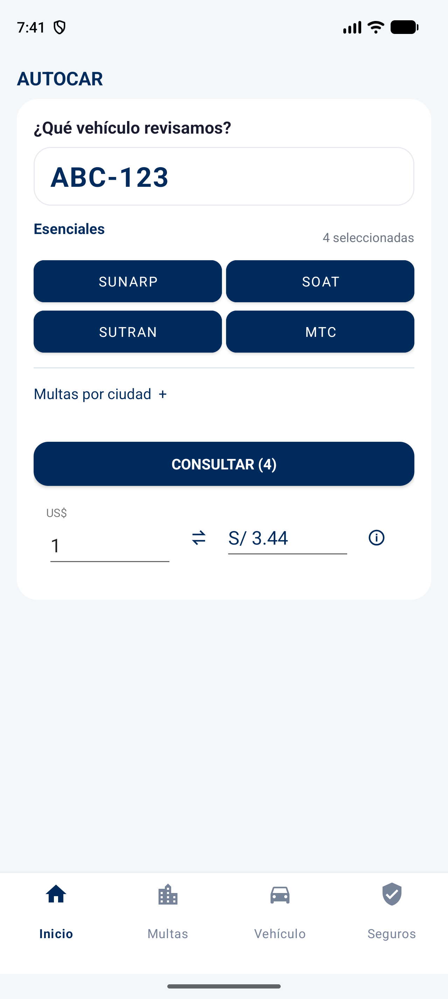
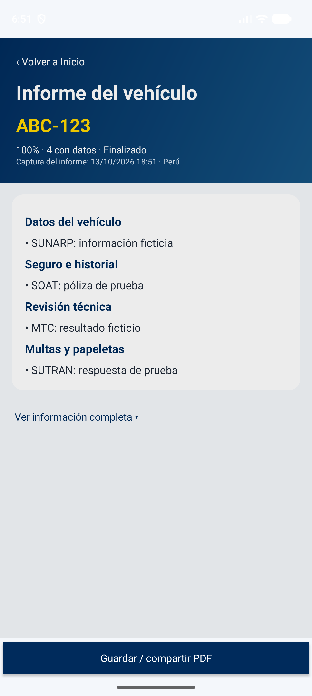

# AUTOCAR — Consulta vehicular en Perú

### v1.42 · Publicación consolidada

Inicio compacto, navegación superior Inicio / Vehículo / Seguros, fuentes
agrupadas y plegables, verificaciones asistidas con datos locales y PDF visual.
Esta entrega consolida el código local posterior a v1.41. Los portales externos
pueden cambiar o no responder; un resultado pendiente no equivale a ausencia de deuda.

[Descargar APK v1.42](https://github.com/HEYLER1/autocar-consulta-vehicular-kotlin/releases/download/v1.42/AUTOCAR-1.42.apk)

### v1.41 · Código de seguridad a la vista

Las verificaciones asistidas muestran una vista compacta del portal y llevan
al código de seguridad cuando el formulario está listo. Se puede ampliar el
formulario para revisar datos y resultados. El código lo ingresa el usuario.

### v1.40 · Fuentes plegables

Cada grupo de fuentes se abre por separado e indica cuántas opciones están
seleccionadas. Los datos de SUTRAN se editan dentro del grupo de verificación.

### v1.39 · Inicio compacto

Se quitan el encabezado de marca y los títulos redundantes del formulario.
La placa y el botón Consultar quedan visibles en un bloque más corto.

### v1.38 · Selector organizado

Inicio separa las fuentes esenciales, las multas municipales y los formularios
que requieren verificación en el portal, sin cambiar la selección guardada.

### v1.37 · Seguros sin consultas duplicadas

El SOAT de SBS del lote queda en Inicio. Seguros conserva APESEG y el acceso
al reporte ampliado de SBS, que incluye CAT y seguro vehicular.

### v1.36 · Vehículo sin consultas duplicadas

La revisión técnica MTC permanece en Inicio. En Vehículo se distingue el
acceso a trámites SUNARP de la consulta vehicular del lote.

### v1.35 · Verificación dentro de Inicio

Captura, Depósito y Cinemómetro quedan plegados al consultar. Sus formularios
se abren dentro de Inicio con autorrelleno; el envío sigue siendo manual.
Impuesto vehicular conserva su enlace a Virtual SAT.

### v1.34 · Apertura de formularios

Consultar placa abre el primer formulario compatible seleccionado entre
Captura, Depósito y Cinemómetro. El autorrelleno espera brevemente los campos
visibles y no sustituye datos escritos. Los demás formularios quedan pendientes.

### v1.33 · Fuentes asistidas en Inicio

Captura, Depósito, Cinemómetro e Impuesto se eligen en el mismo selector.
Al consultar, quedan como verificaciones pendientes junto al lote. Los
formularios compatibles reutilizan la placa y, en Cinemómetro, el perfil local.
No se cuentan como resultados del PDF.

### v1.32 · Cinemómetro por placa

Al abrir Cinemómetro desde Inicio, AUTOCAR selecciona el modo Placa una vez y
rellena los campos visibles tras la recarga oficial. No completa el CAPTCHA ni
pulsa Buscar.

### v1.31 · Verificaciones visibles

Captura, Depósito, Cinemómetro e Impuesto están accesibles desde Inicio sin
abrir un menú intermedio. El acceso a editar datos de SUTRAN queda en el mismo
bloque. Se conserva el autorrelleno local y el envío manual.

### v1.30 · Autorrelleno local

En Inicio → Verificaciones manuales → Datos de SUTRAN se guarda o borra el DNI
y su dígito verificador. El perfil solo se usa en el formulario oficial de
Cinemómetro y se excluye de las copias y transferencias. Captura y Depósito
rellenan la placa de Inicio. El usuario revisa, verifica y envía el formulario.

### v1.29

Inicio reúne las fuentes del lote y los accesos manuales a Captura, Depósito,
Impuesto y Cinemómetro. Se retiran la pestaña Multas y el directorio de Sullana.
Los accesos manuales no se contabilizan como resultados del lote.

### v1.28 · Multas sin duplicados

La pestaña Multas muestra solo las verificaciones complementarias. Las fuentes
del lote (incluidas las ciudades) permanecen en Inicio → Elegir fuentes.

### v1.27 · Navegación superior

Inicio, Multas, Vehículo y Seguros pasan a pestañas superiores compactas con
indicador de sección activa. Se elimina la barra inferior de la app.

### v1.26 · Inicio con nueva jerarquía visual

Encabezado compacto, tarjeta principal verde con una sola acción y conversor
identificado en su propio bloque. No cambia el flujo de consultas ni el PDF.

### v1.25 · Inicio renovado

Inicio claro con encabezado tipográfico, tarjeta blanca de placa, campo sin
borde ornamental y botón azul sin sombra. Se mantienen las funciones de v1.24.

### v1.24 · Inicio clásico

Se restaura el Inicio anterior al chat: placa, consulta directa, selector de
fuentes, conversor e historial. Se conservan el resumen vehicular y el PDF.

### v1.23

Se simplifica el aviso de privacidad antes de enviar preguntas a AI Horde.
Una placa enviada sola sigue iniciando la consulta vehicular.

### v1.22 · Saludo sin conexión

Inicio responde localmente a «hola». Para las preguntas generales distingue
errores de DNS, tiempo de espera, acceso anónimo y respuesta inesperada de AI Horde.

### v1.21 · Qué tiene este vehículo

La tarjeta del chat muestra un resumen local de todas las fuentes seleccionadas,
separando lo informado de lo que quedó sin verificar. No envía datos a AI Horde.

### v1.20 · Selección de fuentes

El botón + abre las fuentes esenciales y municipales y desplaza el chat al
inicio del selector, sin pasar por el conversor. La selección se conserva.

### v1.19 · Qwen sin registro

Las preguntas generales usan Qwen 3.5 mediante el acceso anónimo de AI Horde,
sin clave personal ni cuenta. Su disponibilidad depende de los trabajadores y
de la cola. La app pide confirmación antes de compartir la pregunta y nunca
adjunta informes. Consultar placas y exportar el PDF no usan AI Horde.

### v1.18 · Inicio conversacional

Un campo inferior recibe placas o preguntas generales. La consulta oficial
aparece en una tarjeta con acceso al detalle y PDF. El botón + abre fuentes,
conversor e historial de placas. Qwen requiere confirmación antes de enviar una
pregunta y no recibe los resultados oficiales.

### v1.17 · Asistente vehicular

Inicio muestra la placa enviada como burbuja y conserva el panel oficial de
resultados. El asistente opcional responde preguntas generales con Qwen vía
OpenRouter. Usa una clave propia (solo en memoria) y el modelo gratuito
`qwen/qwen3.8-27b:free`, sujeto a cuota y disponibilidad. No recibe informes
ni resultados de las fuentes. La consulta por placa no requiere clave de IA.

### v1.16

«Elegir fuentes» reúne las consultas esenciales y municipales en una sola
sección desplegable. El contador indica cuántas fuentes se consultarán.

### v1.15

Inicio separa la tarjeta principal de placa y consulta de las opciones, el
conversor y el historial. El progreso aparece justo debajo de la tarjeta.

### v1.14

Inicio prioriza la placa y el botón Consultar placa. Las fuentes se editan en
Opciones de consulta, cerradas inicialmente. Se conserva la selección guardada.

### v1.13

Acceso al informe más visible y etiquetas explícitas para ingresar y enviar códigos.
No cambia el motor de consultas ni el PDF.

### v1.12 · Portada visual del informe

El PDF exportado incorpora placa destacada, indicadores de cobertura y cuatro
tarjetas temáticas. Conserva el anexo con resultados, fuentes y evidencia disponible.

### v1.11 · Informe para revisar antes de comprar

El PDF presenta primero el resumen por tema y la cobertura de la consulta.
Luego muestra el detalle y las evidencias disponibles por fuente. Los accesos
manuales y las respuestas pendientes no se presentan como verificaciones.

### v1.10 · Verificaciones complementarias

Las pestañas Vehículo, Seguros y Multas incorporan accesos oficiales para historial
registral, gravámenes y SIGM, TIVe, seguimiento de títulos, lunas oscurecidas, GNV,
financiamiento FISE, APESEG, CAT y seguro vehicular SBS, cinemómetro SUTRAN,
captura, depósito e impuesto SAT Lima y el directorio de papeletas de Sullana.
Se abren en el navegador. No se incluyen como resultados automáticos ni se envían
datos guardados. Los documentos registrales pueden requerir cuenta y pago.

Aplicación Android que centraliza el acceso a consultas vehiculares por placa y presenta un resumen de las fuentes consultadas. Incluye un directorio de multas y papeletas, consultas de SUNARP, SOAT mediante SBS, infracciones SUTRAN y revisión técnica MTC.

Es un prototipo en desarrollo para evaluar la eficiencia de acceso a información. No es una aplicación oficial de las entidades y no certifica la ausencia de multas, accidentes o cargas registrales.

## Capturas de la aplicación

Capturas de interfaz en el emulador Android, tomadas el 13 de octubre de 2026: Inicio corresponde al diseño v1.6, conservado en v1.8; el informe ilustra una versión anterior del diseño general. Inicio utiliza `ABC-123` como ejemplo, sin consultar esa placa. El informe muestra **datos ficticios de una prueba de interfaz**, no resultados oficiales ni mediciones del piloto. No se publican propietarios, DNI ni resultados personales.

<p align="center">
  
  
</p>

De izquierda a derecha: **Inicio** e **Informe general**. La consulta y los captchas permanecen en Inicio; «Ver resultados», debajo del progreso, abre el informe a pantalla completa.

## Funciones implementadas

- Ingreso, normalización y validación de placas peruanas; historial local de placas recientes.
- Navegación superior: Inicio, Vehículo y Seguros. Las multas municipales se seleccionan en Inicio.
- Directorio de fuentes nacionales y municipales, con consultas abiertas en WebView y opción de abrir el navegador externo.
- SUNARP, SOAT/SBS, SUTRAN y MTC preseleccionados y separados de las ciudades; el usuario puede desmarcarlos. Se ejecutan únicamente las fuentes seleccionadas.
- El mismo botón alterna entre **Consultar** y **Cancelar**, impidiendo iniciar una segunda consulta mientras la primera sigue activa.
- Porcentaje por fuentes terminadas, con datos recibidos, errores y verificaciones pendientes diferenciados.
- Captchas compactos y ocultos hasta abrir «Verificar»; el captcha de imagen se reconoce localmente con ddddocr, el código se completa y se envía solo, y si el portal lo rechaza se recarga la fuente desde su dirección original para pedir un captcha nuevo, que se reconoce y se vuelve a enviar (hasta 3 recargas por fuente). Nunca se repite el mismo código rechazado.
- Recomendaciones orientativas por prefijo de placa: las fuentes locales aparecen primero después de las prioritarias, sin seleccionarse automáticamente. La zona registral no determina dónde puede haber multas.
- Conversor de soles y dólares visible en Inicio. Utiliza una tasa diaria referencial de ExchangeRate-API; no es una cotización bancaria en tiempo real. El monto ingresado no se envía a la API.
- Informe general a pantalla completa, agrupado en vehículo, seguro, revisión técnica y multas, con el detalle extraído completo desplegable.
- Flujo conjunto de multas por placa, con adaptadores por fuente, verificaciones agrupadas e informe PDF que se actualiza con los datos recibidos y los estados pendientes.
- Pantalla de verificación para revisar los códigos de seguridad de SUTRAN y MTC, reconocidos y enviados automáticamente, y corregibles a mano cuando el portal los rechaza, conservando la sesión de cada consulta.
- Resumen de pólizas reportadas por SBS, vigencias, uso declarado e información de siniestralidad disponible.
- Generación y compartición de un informe PDF; puede adjuntar la imagen oficial recibida de SUNARP.

El captcha de imagen se lee en el propio dispositivo con el modelo de ddddocr; la imagen no se envía a ningún servidor. El texto reconocido se completa y se envía automáticamente. Cuando la verificación no se supera, la fuente no se reintenta sobre el mismo formulario: la página se recarga desde su dirección original para pedir una sesión y un captcha nuevos, y el código se reconoce y se envía otra vez, con un máximo de 3 recargas por fuente. Si aun así no se supera, la imagen más reciente queda en el panel para escribir el código a mano; si el motor no está disponible o no supera el umbral de confianza, el ingreso también es manual. Las verificaciones interactivas (reCAPTCHA/hCaptcha) no se alteran. Consulta [Reconocimiento de captchas](docs/ddddocr.md) para el alcance, la atribución MIT y las limitaciones.

## Alcance y limitaciones

Inicio inicia las consultas seleccionadas y reúne el detalle extraído en un PDF. Las fuentes prioritarias reutilizan el motor anterior; las municipales conservan adaptadores propios. La automatización depende del formulario y de la disponibilidad de cada fuente: no todas pueden completarse sólo con una placa. El informe identifica consultas incompletas, errores y verificaciones pendientes; no debe presentarse como cobertura municipal total. Véase la [revisión por fuente](docs/verificacion_fuentes_2026-10-13.md).

El informe a pantalla completa es una captura del estado al abrirlo: si quedan consultas pendientes, se vuelve a Inicio y se abre de nuevo para obtener un informe actualizado. El PDF asociado conserva ese estado.

La disponibilidad depende de los servicios externos, sus certificados, formularios y controles de seguridad. Un portal accesible por HTTP no demuestra que una consulta por placa funcione de principio a fin. Un fallo, una consulta pendiente o un captcha sin resolver nunca deben interpretarse como cero multas.

El reporte SBS puede tener desfase de actualización. El uso declarado en una póliza describe ese registro, no demuestra toda la historia de uso del vehículo. El resumen es orientativo y no reemplaza documentos oficiales ni una inspección previa a la compra.

## Tecnología

Aunque el repositorio se llama `autocar-consulta-vehicular-kotlin`, las pantallas y la lógica principal actuales están escritas en **Java**, con vistas XML y Android WebView. Kotlin aparece en las pruebas y en los archivos de configuración Gradle Kotlin DSL. No utiliza React Native ni Expo.

| Componente | Configuración del proyecto |
|---|---|
| Identificador | `com.example.app_autocar` |
| Versión local actual | `1.10` — código `10` |
| Android mínimo | API 34 (Android 14) |
| SDK de compilación y destino | API 37 |
| Gradle Wrapper | 9.6.0, con checksum configurado |
| Compatibilidad Java del código | Java 11 |
| Interfaz | AppCompat, Material Components, XML |
| Reconocimiento de texto | Google ML Kit |
| Reconocimiento de captchas | ddddocr con ONNX Runtime para Android (modelo `common_old.onnx`) |
| PDF | Android `PdfDocument` y `FileProvider` |

## Ejecutar en Android Studio

### Instalar el APK de prueba

Las nuevas entregas se guardan por versión: `dist/AUTOCAR-1.2.apk`, después `AUTOCAR-1.3.apk`, etc. Los APK anteriores se conservan. Para guardar una entrega sin sobrescribir versiones existentes:

```bash
./gradlew :app:saveVersionedApk
```

La versión actual es v1.42. Guardar PDF abre el selector de archivos; compartir utiliza el menú de Android. Consulta la [estructura del código](docs/estructura_codigo.md). Los APK nuevos se distribuyen como adjuntos de GitHub Releases por su tamaño; los archivos históricos locales en dist se conservan.

[Descargar AUTOCAR v1.42 con logo](https://github.com/HEYLER1/autocar-consulta-vehicular-kotlin/releases/download/v1.42/AUTOCAR-1.42.apk)

APK de depuración firmado, generado el 21 de noviembre de 2026 y guardado en `dist/AUTOCAR-1.42.apk`. Requiere Android 14 (API 34) o superior. Android puede solicitar permiso para instalar aplicaciones desde el navegador o administrador de archivos. No es una versión de producción ni se publica en Google Play. Se conservan los APK de entregas anteriores.

La compilación, las pruebas unitarias y lint se verifican antes de publicar. Las pruebas instrumentadas comprueban selección, cancelación, progreso, captchas con formularios ficticios, el envío automático con límite de intentos y renderizado del informe; no certifican todas las consultas reales de los portales externos.

### Abrir y compilar el proyecto

1. Clonar el repositorio y abrir su carpeta raíz en Android Studio.
2. Instalar el SDK Android API 37 y configurar el JDK compatible con el Gradle del proyecto; en el entorno de desarrollo se utiliza el JDK incluido en Android Studio.
3. Sincronizar Gradle. Se requiere conexión para descargar la distribución y las dependencias.
4. Seleccionar un dispositivo o emulador con API 34 o superior y ejecutar el módulo `app`.

Android Studio genera `local.properties` con la ruta local del SDK. Este archivo no se publica.

```bash
git clone https://github.com/HEYLER1/autocar-consulta-vehicular-kotlin.git
cd autocar-consulta-vehicular-kotlin
./gradlew :app:testDebugUnitTest :app:assembleDebug :app:lintDebug
```

Si aparece `UnknownHostException: services.gradle.org`, comprobar conexión, DNS y configuración de proxy. No desactivar la validación TLS para resolverlo.

### Integración opcional con PlacAPI

El proyecto lee `PLACAPI_KEY` desde `local.properties` únicamente para la compilación de depuración. Sin clave, utiliza el flujo de los portales oficiales. La compilación release deja esta clave vacía.

Una clave incorporada en un APK puede extraerse: para producción, cualquier servicio privado debe gestionarse mediante un backend y credenciales restringidas. No publicar claves, archivos de firma ni datos personales de consultas.

## Evidencia y estado de validación

Las evidencias técnicas y sus límites se documentan en [Verificación técnica](docs/verificacion_tecnica.md). El inventario histórico de fuentes y sus observaciones está en [Fuentes de multas](docs/fuentes_multas_peru.md); algunos enlaces de ese inventario requieren revalidación y no representan exactamente el directorio actual.

| Función | Evidencia en el código |
|---|---|
| Placas y validación | [PlateUtils.java](app/src/main/java/com/example/app_autocar/PlateUtils.java), [pruebas unitarias](app/src/test/java/com/example/app_autocar/ExampleUnitTest.kt) |
| Menú y directorio | [MainActivity.java](app/src/main/java/com/example/app_autocar/MainActivity.java), [menú inferior](app/src/main/res/menu/main_navigation.xml) |
| Portales y navegación | [WebViewActivity.java](app/src/main/java/com/example/app_autocar/WebViewActivity.java) |
| Motor de las cuatro fuentes prioritarias | [PriorityQueryEngine.java](app/src/main/java/com/example/app_autocar/PriorityQueryEngine.java) |
| Consulta integrada, progreso y captchas | [UnifiedQueryPanel.java](app/src/main/java/com/example/app_autocar/UnifiedQueryPanel.java), [pruebas instrumentadas](app/src/androidTest/java/com/example/app_autocar/FinesAutomationTest.kt), [envío automático](app/src/androidTest/java/com/example/app_autocar/UnifiedQueryPanelAutoVerifyInstrumentedTest.kt) |
| Reconocimiento local de captchas | [DdddOcrEngine.java](app/src/main/java/com/example/app_autocar/DdddOcrEngine.java), [prueba instrumentada](app/src/androidTest/java/com/example/app_autocar/DdddOcrEngineInstrumentedTest.kt) |
| Adaptadores municipales y PDF | [FinesPortalAdapter.java](app/src/main/java/com/example/app_autocar/FinesPortalAdapter.java), [FinesPdfReport.java](app/src/main/java/com/example/app_autocar/FinesPdfReport.java) |
| Informe general | [GeneralVehicleReport.java](app/src/main/java/com/example/app_autocar/GeneralVehicleReport.java), [GeneralReportActivity.java](app/src/main/java/com/example/app_autocar/GeneralReportActivity.java) |
| Conversor y recomendaciones | [CurrencyConverter.java](app/src/main/java/com/example/app_autocar/CurrencyConverter.java), [PlateRegion.java](app/src/main/java/com/example/app_autocar/PlateRegion.java) |
| Restricciones de red | [network_security_config.xml](app/src/main/res/xml/network_security_config.xml) |

La presencia de código, una compilación exitosa y las pruebas unitarias no equivalen a una validación completa de los portales ni del contenido del PDF.

## Investigación y prueba piloto

El prototipo permite preparar comparaciones entre consulta directa y consulta desde la app. Todavía no se publican resultados experimentales que demuestren reducción de tiempo o pasos, cobertura completa o concordancia de resultados municipales.

El piloto debe seleccionar fuentes con consulta por placa verificable, congelar la versión evaluada y registrar pares de consultas con la misma placa, fuente, dispositivo y conexión. Deben medirse tiempo, acciones, cobertura y concordancia, conservando incidencias y consultas fallidas. Las fichas de medición pueden ser externas a la app.

SUNARP, SOAT y revisión técnica son funciones complementarias; no sustituyen la muestra de multas municipales. La descripción tecnológica del protocolo debe corresponder a la implementación nativa actual.

## Estructura

```text
app/src/main/java/com/example/app_autocar/  Actividades y lógica
app/src/main/res/                          Vistas, estilos y configuración
app/src/test/                             Pruebas unitarias
app/src/androidTest/                      Pruebas instrumentadas
docs/                                     Inventario y evidencias
gradle/                                   Wrapper y catálogo de versiones
```

## Autoría y licencia

Proyecto mantenido por [HEYLER1](https://github.com/HEYLER1). No se ha añadido una licencia de uso: la publicación del código no implica una licencia abierta. Los nombres y servicios de terceros pertenecen a sus respectivas entidades.

## Actualización local v1.6

Inicio compacto: SUNARP, SOAT, SUTRAN y MTC visibles; las ciudades se seleccionan en «Multas por ciudad», cerrado por defecto y con contador. La selección se conserva y se bloquea durante una consulta. El selector se cierra al consultar. Formulario principal con jerarquía visual más clara e informe con placa destacada y acciones PDF compactas. Motor de consultas sin cambios. APK: `dist/AUTOCAR-1.6.apk`.

## Actualización local v1.7

Diseño consistente en Multas, Vehículo y Seguros: directorio visible, búsqueda directa y estado vacío explícito, filas con descripciones legibles y separadores. SUNARP tiene acceso discreto a datos locales; navegador interno con iconos compactos. Progreso, fuentes y verificación mantienen su flujo original con menor peso visual. Informe general separado por temas y enlace visible a toda la información. No se altera el contenido ni el diseño de los portales oficiales ni el motor de consultas. APK: `dist/AUTOCAR-1.7.apk`.

## Actualización local v1.8

Limpieza de filtros ocultos y recursos sin referencias, retirada del generador antiguo de informe/PDF y métodos sin uso, catálogo de fuentes separado de la pantalla y formato uniforme del código Java. Se conserva el motor de consultas y el contenedor usado por las pruebas. [Guía del código](docs/estructura_codigo.md). APK: `dist/AUTOCAR-1.8.apk`.

## Actualización local v1.10

Accesos oficiales complementarios desde Vehículo, Seguros y Multas (historial registral, gravámenes y SIGM, TIVe, seguimiento de títulos, lunas oscurecidas, GNV, financiamiento FISE, APESEG, CAT, seguro vehicular SBS, cinemómetro SUTRAN, captura, depósito e impuesto SAT Lima y directorio de papeletas de Sullana), abiertos en el navegador y sin enviar datos guardados.

Reconocimiento local de captchas de imagen con el modelo y el alfabeto de [ddddocr](https://github.com/sml2h3/ddddocr) ejecutados por ONNX Runtime para Android. El código reconocido se completa y se envía automáticamente. Cada imagen se identifica por su contenido: al aparecer una imagen distinta se descarta el código anterior, se reconoce la nueva y se envía ese resultado, incluso si el portal sustituye la imagen sin recargar la página, hasta 10 intentos por fuente. Después el campo queda editable para el ingreso manual. No se envían captchas a servidores ni se modifican tokens de verificación interactiva. Incluye el modelo `common_old.onnx` como asset, pruebas unitarias de decodificación CTC, una prueba instrumentada del modelo y pruebas del envío automático con límite de intentos. Detalles, atribución MIT y limitaciones en [Reconocimiento de captchas](docs/ddddocr.md). La entrega 1.9 se sustituyó por 1.10 antes de publicarse, por lo que la versión distribuida es `dist/AUTOCAR-1.10.apk`.
